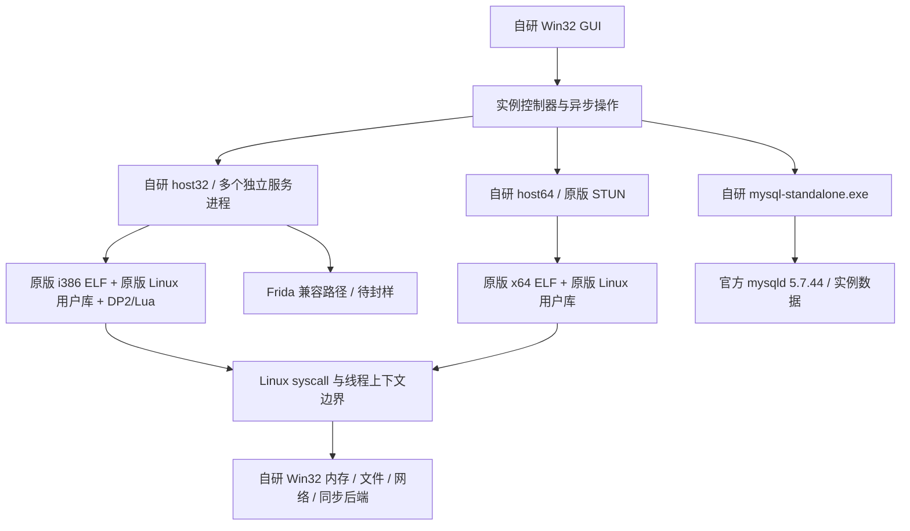

# 原生运行技术方案

本方案以[需求原文](requirements.md)和[资源证据](01-resource-research.md)为依据。路线是保留 Linux 用户态库语义，独立实现 Linux 内核 ABI 到 Windows 的兼容层。本文描述设计要求，实际完成范围见[实施记录](06-progress.md)，未验证能力不计为通过。

## 1. 交付边界与关键决策

| 事项 | 推荐决策 | 依据 / 限制 |
|---|---|---|
| 服务身份 | 原包封样 ELF，由自研 x86/x64 宿主执行；一个有效服务实例对应独立 Windows 执行进程 | 不编译 rednf 服务替代，不复用参考 loader |
| 用户态 ABI | 运行独立获取并锁定的 Linux `ld.so`、glibc、libstdc++、libgcc 等依赖 | 避免从零仿制 libc/C++/pthread；同名符号不能代替布局与行为一致 |
| 基线候选 | CentOS 7 系列 glibc 2.17 / GCC 4.8.5 用户库，i686 与 x86_64 分开封样 | 已从 CentOS Vault 独立导入并验证十个 RPM，原版 manager/STUN 进入初始化；完整闭包及插件 `GLIBC_PRIVATE` 仍须专项核对 |
| CPU 执行 | x86/x64 机器码在同架构宿主直接执行；只讨论受控 ABI 入口和局部 TLS/syscall 适配 | 不引入通用 CPU 模拟器、全程序动态翻译或驱动；局部指令改写边界须先审阅 |
| 原地址 | game 的 `ET_EXEC` 地址与入口保持；宿主、依赖和辅助桩避让 | 不能为解决地址冲突重定位主 ELF |
| 插件 | DP2 与 game 同进程，原指针与 Lua/C ABI 保持 | 旁路 RPC 不能替代进程内对象接口 |
| 数据库 / GUI | 独立 MySQL 5.7.44 自解压程序 + 本项目原生 Win32/C++ GUI | 设计见[数据库与交付方案](03-database-and-delivery.md) |

“完整模式 19 服务”和“默认 core 16 服务”分别保留：完整模式仍验收三件套；core 的裁剪必须由依赖及业务验证证明可选。原始启动脚本默认会运行三件套，不能直接认定其不必要。若它们是默认可玩链必需项，就报告需求之间的冲突，不能伪装成功或偷偷改变包组成。

## 2. 模块与进程结构

图中共享模块表示共同代码和接口，不表示跨进程共享一份内存状态。每个宿主独立管理本进程的 VM、fd、PID/TID 映射和 guest 线程上下文；跨服务共享对象通过实例隔离的 Windows 内核对象实现。原版 `fork` 的中间父子进程也必须可追踪，不能把宿主、诊断进程或 MySQL 计成原版服务。

计划的代码边界如下，实施中按当前需要建立文件，避免预建空框架：

| 模块 | 职责 |
|---|---|
| `runtime/boot` | 校验输入、主程序与解释器映射、初始栈、进入 guest |
| `runtime/arch` | i386/x86_64 syscall 入口、寄存器、guest/host 上下文和栈切换 |
| `runtime/kernel` | Linux syscall 分派及 VM、fd、进程、线程、信号、IPC 语义 |
| `runtime/win` | 可在目标 Windows 基线上使用的 OS 原语 |
| `runtime/adapt` | 独立编写的指令适配与补丁冲突记录 |
| `manager` | 实例、服务清单、依赖、就绪、退出和操作事务 |
| `gui` | 原生控件、状态展示与操作入口；不含 ELF 或业务补丁逻辑 |
| `packaging` | MySQL 自解压、依赖清单、离线发布审计 |

开发机可以使用构建工具，但运行包不依赖 Python、编译器、.NET、联网下载或外部运行环境。工具链须另行封样，目标 API 基线、CRT、x86 大地址能力及最终 PE 导入要在三种系统上验证；不能仅靠 `_WIN32_WINNT` 宏宣称兼容 Win7。

## 3. ELF 启动与动态链接

宿主负责最小启动，不再写一套替代 glibc 的动态链接器：

1. 通过同一受控文件身份读取并校验主 ELF、解释器和依赖哈希，核实架构、程序头范围、文件长度、入口、加载地址和权限。
2. 按 `PT_LOAD` 映射主程序与对应 `PT_INTERP`，处理 BSS、页边界及重叠页；主程序保持原虚拟地址，解释器选择无冲突位置。
3. 构造 Linux 初始栈，保留原 `argv`、`envp` 和所需 auxv；`AT_PHDR`、`AT_PHENT`、`AT_PHNUM`、`AT_ENTRY`、`AT_BASE` 等对应真实映像。不得公布尚未实现的 vDSO 能力。
4. 从原解释器入口开始，让原 `ld.so` 处理依赖、符号版本、重定位、TLS、构造函数和预加载，再进入原 `_start`。
5. 验证 `main` 返回、`exit`、`_exit`、动态库卸载及异常退出的真实生命周期，避免重复执行构造或析构。

依赖闭包包含运行期 `dlopen`、NSS、locale、时区、线程库和插件扩展；不仅比较 `DT_NEEDED`。动态加载的文件同样执行哈希与架构检查。版本化符号、弱符号、COPY/TLS 重定位、数据符号、异常展开和 `GLIBC_PRIVATE` 保持由真实用户库处理，后端仍须满足其内核假设。

x86 宿主需验证 WOW64 下的可用地址空间、大地址标记及宿主 DLL 避让；x64 宿主避开 STUN 的 `0x00400000`。映射失败时输出冲突区域与所属模块，不通过移动 game、去除 ASLR 保护或覆盖现有映射强行继续。

## 4. syscall 与 TLS 的可行性封样

这部分是最高技术风险，不能依据历史实验结果视为已解决。

| 路径 | 候选方法 | 必须证明 |
|---|---|---|
| i386 syscall | 捕获 guest 中的 `int 0x80`；按需提供经过验证的 guest sysinfo 入口 | 实际异常码/PC、六参数、64 位参数拆分、负 errno、阻塞重启、嵌套与并发 |
| x86_64 syscall | 将已确认的 guest `syscall` 站点原位替换为等长受控陷阱并分派 | 不误执行 Windows syscall；恢复 Linux 约定的寄存器、RCX/R11、标志与返回 PC |
| i386 GS / x64 FS | 将已确认的 guest TLS 指令导向受控辅助桩，逻辑 TCB/DTV 仍属原 glibc | 不破坏 Windows TEB；跨调度、异常、信号、Frida 回调和动态模块一致 |

不假设修改 FS/GS base 在 Windows 调度后仍可靠，也不使用未声明的 TEB 空槽。通过公开 TLS API和受控线程上下文保存 guest 状态；快路径只能在正确性通过后优化。进入 Windows API/C 代码前切换到合规宿主栈和 ABI，返回时恢复 guest 寄存器、栈对齐、FPU/SSE、errno 所属状态和可重入上下文。

指令适配规则：

- 原始磁盘文件不变，主函数与数据地址不变；派生缓存以输入哈希、架构、适配器版本和补丁集合为键。
- 每一处改写记录模块哈希、原地址、原字节、新字节、原因、辅助桩及恢复信息。只处理可靠解码的执行指令，不扫描字节子串直接替换。
- 辅助桩不得破坏中间跳转目标、相对寻址、异常展开、断点或被 hook 的函数边界；不能安全处理的站点明确失败。
- 跟踪 `dlopen`、`mmap/mprotect` 可执行页及保护库展开后的代码。静态扫描无法证明自修改代码和运行期生成代码已覆盖，必须专项验证。
- 补丁与适配在同一登记表中检查重叠、执行顺序和并发写入。补丁看到真实内存；不能声称同时存在未经验证的“原始读取视图”和“改写执行视图”。

若原址机器码补丁或 Frida hook 与必要适配无法共存，该能力判失败；不得改成通用模拟执行、假装旧字节校验通过或把冲突脚本排除出验收。是否接受这些窄范围原位适配，是审阅时需确认的技术边界。

## 5. Linux 语义与 Windows 后端

| 子系统 | 必需语义与验证重点 |
|---|---|
| VM | Linux 页粒度、`brk`、匿名/文件 `mmap`、`munmap`、`mprotect`、所需 `mremap`、固定地址、COW、共享映射、文件偏移与 BSS |
| fd / I/O | fd 与 HANDLE/SOCKET 分离；`dup`、共享文件位置、CLOEXEC、非阻塞、管道、stdio、短读写和错误翻译 |
| 网络 / 等待 | TCP/UDP、`socketcall` 与各架构入口、`select/poll/epoll`，ET/ONESHOT、ERR/HUP、超时、关闭/复用竞态和混合 fd |
| 线程 / futex | `clone` 线程路径、TLS、线程退出、`clear_child_tid`、私有/共享 futex 队列；robust list 等按实际依赖验证 |
| 进程 | guest PID/TID、`fork/exec/wait/setsid`、环境与 fd 继承、退出状态、daemon 父子关系；仅支持已证明正确的行为 |
| 信号 | pending/mask、目标线程、信号栈、Linux signal frame、`sigreturn`、EINTR/SA_RESTART 与 Windows 异常区分 |
| IPC | POSIX/System V 共享内存、信号量及实际使用的消息机制；同实例真实跨进程共享，不用私有副本替代 |
| VFS / proc | guest 根目录、CWD、符号链接、`/proc/self/exe`、maps/tasks、`/dev/null`、随机源及实际使用的虚拟文件 |
| 时间 / 系统信息 | Linux 时钟、超时、真实随机数据、架构与进程信息；不把宿主结构体直接传给 guest |

不能预设“只有约 120 个 syscall”，也不能按数量计算完成率。按原程序触发路径形成支持矩阵；未知 syscall 返回符合 Linux ABI 的明确错误（通常为 `-ENOSYS`），记录来源、编号和上下文。仅对已正确实现的操作返回成功，不通过静默回退削弱语义。

**Win7 的 VM 是独立否决关卡。** Windows 通常有 64 KiB 分配粒度，而 Linux 程序按 4 KiB 页操作。匿名区可探索整块保留、分页提交；初始 ELF 私有段可按规则读入保留区，但不能因此把普通文件映射、COW 和共享映射也替换成私有拷贝。必须验证非 64 KiB 偏移、部分解除映射、同一文件双别名、跨进程共享写及可执行权限转换。Win10 placeholder API 不能成为 Win7 的必要依赖；无法用目标系统支持的原语满足实际工作负载时，应停止该路线并报告具体缺口。

Win7 同步后端不得硬依赖 `WaitOnAddress`；候选为 Interlocked、锁和事件队列，需证明“比较并等待”无丢唤醒。共享 futex 用后备对象身份和偏移标识，不能拿两个进程中的不同虚拟地址当成同一个键。

VFS 在 guest 内保持原路径语义，通过明确编码转换调用 Windows `W` API，验证中文、空格、括号路径。对大小写、重解析点、特殊文件名及无法表示的路径给出明确处理。`/proc` 内容来自受控 guest 模型，不直接暴露不相关宿主模块或伪造 Linux 进程状态。

`fork` 不能统一返回 0 或跳过 daemon 逻辑。先核实原始服务实际使用的父子语义，再验证真实 child、内存状态、fd、TLS、信号和 wait 状态。启动期专用实现只可宣称覆盖已证实的受限场景；不能据此承诺任意多线程 `fork`。

## 6. DP2、Lua、Frida 与补丁

优先复现原链 `LD_PRELOAD=/dp2/libdp2pre.so`，核对其后续动态加载、构造时序、game 初始化时机和 Lua 扩展。`libdp2.so`、`libdp2game.so` 可能存在保护与动态执行路径；本轮没有证明覆盖性，不能按普通未保护 DSO 对待。

Frida 路径先比较并封样，再确定默认交付：

| 路线 | 优点 | 主要关卡 |
|---|---|---|
| 优先试验：运行原包 Linux Frida Gadget | 保留当前脚本平台、模块查询和 guest ABI 语义 | `GLIBC_PRIVATE`、proc/task、线程挂起/信号、可执行页、动态代码与 hook 冲突 |
| 备选：锁定 Windows x86 Gadget + 自研适配 | 使用 Windows 原生 Frida 后端 | ELF 不在 PE 模块列表；需自研导出/模块查询、显式 SysV 调用与回调桥接，并核实 Win7 和旧脚本 API |

备选不等于兼容性已获证明。不得仅因为 DLL 能加载就宣布 Frida 通过，也不能默认升级到 17。原脚本中实际出现 `Module.getExportByName`、`NativeFunction`、`NativeCallback`、`Interceptor.attach/replace`、`Memory.patchCode` 和 `dp2_frida_resolver`，以及 `lua.call`、`frida.main`、`frida.handler`。这些接口及真实参数、返回值、指针与调用时序均需双向验证。

最小插件关卡同时要求：原 DP2 初始化、Lua 脚本执行、Lua→JS→原 game 函数、原 game→JS/Lua 回调、hook 安装与撤销、线程并发、停止重启。验证每次都记录输入和脚本哈希，不能用另写的空插件替代。

等级文件以运行期配置/数据配置描述，包含 ELF/PVF 哈希、地址约束、插件版本和补丁集合。至少封样两个确实匹配的等级组合，在相同宿主构建上切换验证。未知文件先审计并明确兼容状态，不能自动套用另一哈希的固定地址补丁；“不重编 loader”不等于“接受任意未知 ABI”。

## 7. 服务管理与可玩验收

服务清单分别记录实例 ID、原 ELF 路径/哈希/架构、CWD、argv、环境、依赖、启动超时、协议就绪和停止动作。原包 19 项启动顺序作为调查起点，依据实际连接、共享内存和 DB 访问建立依赖图；循环依赖采用组启动后共同检查就绪，不盲猜完整拓扑。

状态至少分为：未启动、加载中、已进入 guest、监听中、协议就绪、业务就绪、停止中、已停止、失败。GUI 显示具体状态；进入 guest、存活和监听均不直接升级为就绪。控制器以实例操作 ID、超时及日志关联服务启动、失败和清理。

启动验证身份与数据库后，按已证实依赖顺序运行；失败按相反顺序收尾。正常停止先让 game 完成存档并验证退出，再关闭依赖服务，最后关闭 MySQL。超时强制终止必须明确标为异常，重启后检查数据一致性。

实例级 Windows Job/句柄所有权用于回收子树；Win7 不依赖嵌套 Job，若宿主已处于不允许加入目标 Job 的环境，必须在运行前明确失败或采用经过验证的进程归属方案。GUI 退出、控制器崩溃和部分 child 退出都需要独立实验，不能因“发出了停止请求”报告停止成功。

三件套可选性要用完整模式与 core 的同版本对照确定，覆盖登录、选角、进图、结算、掉线/重连、存档重启，以及会触发安全/IPC 的路径。不能只看启动无报错。默认 16 可玩、完整 19 启动互通和插件链分别留证，均纳入后续阶段验收。
