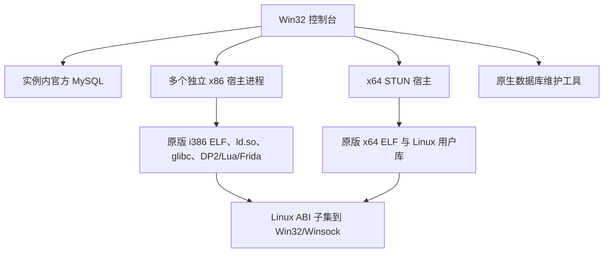

# 实现与兼容边界

本文描述当前源码行为；具体已验证组合和历史故障见[验证记录](validation.md)。服务执行文件来自固定资源基底，项目自研部分是 Windows 宿主、控制台和数据库维护工具。

## 运行关系

普通指令由同架构 CPU 执行，宿主对 syscall 和 Linux TLS 边界进行适配。每个服务是独立 Windows 进程；DP2/Lua/Frida 和 game 保持同进程指针及 ABI。没有引入 CPU 模拟器、通用全程序翻译或内核驱动。

## ELF 宿主

`src/runtime/main.c` 解析 `--map` 和 `--run`，以及 `--root ROOT INTERPRETER_SHA256`、`--cwd`、`--env`。程序 ELF 和动态加载器均按传入 SHA-256 校验，位数不匹配、错误文件边界或缺失入口会明确拒绝。

`elf.c` 以只读文件视图保留输入，再为执行副本映射 PT_LOAD、零填充 BSS 并设置页权限。ET_EXEC 按原地址映射；ET_DYN 分配独立区域。原磁盘 ELF 不因加载和适配被改写。`run.c` 构造 argc/argv、环境、auxv 和初始栈，再经 `entry.S` 进入原动态加载器或程序入口。

`adapt.c` 使用固定 Zydis/Zycore 解码，记录原 syscall/TLS 站点并适配加载副本。x64 syscall 和常规 TLS 陷入经 Windows VEH 分发；x86 `int 0x80` 在异常边界处理。常见 x86 GS 绝对读取可经每线程 Windows TLS 槽和同义 CPU 指令直接执行，保留寄存器与标志。其他已支持的 TLS 由 `tls.c` 处理，未实现站点记录地址并失败退出。

原始 manager 的 GCC PIC 跳转表、特定 Frida 数据/指令和 packed image 处理都有局部识别条件；不能把这些有限适配外推到任意 ELF。所有分发路径的 ENOSYS 记录服务、位数、线程、PC、参数、模块哈希和首次/重复计数；按 1/2/4/8 次采样，返回值保持 ENOSYS。`diagnostics.c` 在 guest 异常边界记录寄存器、原始指令字节、可读局部栈及最多 16 层 frame-pointer 帧；没有帧指针或符号时明确保留未解析地址，不声称完整展开。`tools/elf_manifest.py` 可离线生成资源 ELF 的段、TLS、依赖、重定位类型和未定义动态符号清单，输出必须在 x 下。

| 模块 | 职责 |
| --- | --- |
| `diagnostics.c` | ELF 模块身份、符号定位、重复 ENOSYS 和异常现场；以加载器/VM 原表为准 |
| `run.c` | Linux 初始上下文、异常分发、基础 syscall、内存有效性检查 |
| `vm.c` | mmap/mprotect/munmap/madvise/msync 和有限 x86 mremap |
| `files.c` | 实例根目录映射、文件/目录/锁、部分 procfs 和共享文件 |
| `net.c` | TCP/UDP、select/poll、LT epoll、已支持的 socket 选项 |
| `thread.c` | 已观察 pthread clone、TLS 接入、futex/wake/requeue 子集 |
| `signal.c` | 当前服务所需处理器、掩码、SIGTERM/SIGUSR2 及上下文恢复 |
| `tls.c` | Linux FS/GS TLS 指令适配和返回路径 |

映射表最多 4096 项，记录已使用前缀并复用空槽。VM 修改、内存检查和异常读取使用同一进程内临界区，防止 guest 线程争用映射槽。文件与 socket 共用 256 项描述符，线程表为 64 项；这些是当前容量边界。

## 控制台与实例

`src/controller/controller_gui.cpp` 使用原生 Win32 控件和一个后台操作线程，操作进行时限制冲突按钮。共享文件接口在 `src/win32_files.h`，支持 Unicode 路径和私有文件权限；ZIP 通过 miniz 和 Win32 HANDLE 解压。

当前 GUI 采用两栏工作区：顶部显示当前实例和全局操作；左栏集中数据库、维护摘要、服务 IP 与四组可折叠的单列服务列表；右栏显示服务元数据、就绪层级、单项操作及日志。支持全部/运行中/功能组筛选；显示行单独映射到服务索引，筛选和折叠不改变 `services.ini` 的启停顺序，并保留当前服务选择。详情显示根目录、CWD、ELF 哈希、架构、停服信号和自动启动设置；清单没有声明的端口/依赖明确显示未声明，运行时通道接入与接口、协议、业务验证分开显示。数据库摘要显示实例 UUID、逆序停服预览、维护目标和结果，操作日志记录实际启停顺序。窗口布局按客户区和 DPI 重新计算；按钮使用蓝色焦点环。阶段原始收据位于仓库外 `../x/dnf-native-output/P1-20261115/` 和 `P2-20261115/`。

`instance_setup.h` 从 v4 清单校验两个 ZIP、两个宿主和数据库维护工具的身份。新建仅接受空目录，解压后逐文件核对；官方 MySQL 安全初始化后导入 18 个应用库，重新导出与种子 SHA-256 比对。随后生成每实例应用账号、更新数据库连接、准备当前月表、写入服务配置，正常停库后提交实例。失败保留 pending 标记和私有诊断。

新资源包以一个 Linux 目录树释放到实例根目录，服务清单 `root=.`；`home/neople/` 汇集所有服务，`dp2/` 保存插件，`lib/` 与 `lib64/` 保留 Linux 原有库位数区分。已有拆分目录实例继续由原清单解析，不自动迁移用户数据。

`services.ini` 保存 19 个服务的宿主位数、根目录、原 ELF 与 loader 哈希、参数、环境、停服信号和自动启动标志。顺序是 bridge、manager、三个 DBMW、monitor、guild、statics、coserver、community、auction、point、channel、relay、stun、game；zergsvr/secagent/gunnersvr 默认不自动启动。

`service_processes.h` 先以挂起状态创建宿主、加入本窗口的 Job，再恢复执行并等待停服通道。该通道仅说明 runtime 已接入，GUI 明确显示“业务未验证”。正常停止使用本项目命名事件向原程序交付信号；STUN 另发 UDP 数据唤醒阻塞接收。超时保留进程和依赖供诊断。正常停服后仅清理由本窗口已退出宿主拥有的 PID 标记。

实例选择持有独占 `.instance.lock`。删除仅允许已识别、已停止的真实实例目录，需要确认；递归处理普通目录，遇 reparse point 只移除链接自身。资源 ZIP 和外部原件不作为运行实例写入。

IP 更新集中于 `service_ip.h`，修改前备份原配置；DP2/Lua/Frida 环境由服务清单和插件模式生成。`log_view.h` 与 GUI 仅读取原日志末尾至多 256 KiB，支持编码、轮转、截短及跟随，不改写原始日志。控制台操作记录单独显示。

## 数据库维护

`src/database/mysql_control.cpp` 调用实例自己的官方 MySQL 5.7.44 工具。产品不安装服务，也不扫描和复用本机其他 MySQL。GUI 运行时通过 SQL 核对版本、server UUID、本次 PID 文件名及 TLS，确认属于本窗口的数据库后才发正常停库命令。

`mysql_operations.h` 实现：

1. **备份**：确认数据目录已停止，以禁 TCP 的独立共享内存端点启动维护数据库，逻辑导出全部库、账号、存储程序、事件和触发器，正常停库后写入带哈希的清单。
2. **还原验证**：验证备份、连接配置及实例 UUID，先保存当前逻辑预备份，再逐文件复制并核对冷数据到影子目录；只在影子副本中移除旧应用库并导入。
3. **提交**：重启影子库、重新导出并逐字节核对逻辑备份，写 `restore.pending` 后保留旧冷目录、切入新目录，启动核对身份并正常停止，再删除 pending 标记。
4. **恢复**：失败或中断时通过 pending 日志恢复原冷目录，保留被拒绝的数据和诊断；解析无效的日志会明确失败，不猜测恢复。

MySQL 的 NTFS 配置使用 `lower_case_table_names=1`。历史原库导入和二进制/存储程序往返另有独立证据，不能据一次简单 SQL 查询推断所有数据库语义。中文 defaults 路径使用实例工作目录内的相对配置名。

## 已确认的兼容限制

- 当前采用原服务的前台 `run/nofork/test` 入口；通用 fork/exec/wait、setsid 和后台父子语义未提供完整支持。
- `/dev/shm` 的真实共享文件映射已有路径；System V shm/sem 不等于文件映射，尚无通用实现。
- 网络以现有 TCP/UDP、select/poll、LT epoll 路径为主；AF_UNIX、完整 sendmsg/recvmsg 辅助数据、ET/ONESHOT 等未完成。
- 线程退出槽复用、robust owner death、pthread cancel 和通用线程定向信号未完整覆盖。
- SA_SIGINFO、备用信号栈、纯计算中的异步抢占和完整 syscall 中断/重启语义仍有限。
- 打开目标上的 POSIX rename、符号链接、任意私有文件 COW、跨多个预留区固定映射及部分 msync 行为存在边界。
- inotify_init/init1 仍可返回 ENOSYS，当前 Frida 路径可 fallback；不能宣称通用文件热加载支持。
- 保留原地址不等于任意等级 ELF/PVF 都兼容；每个新组合都需要匹配资源和独立业务验证。

## 基底与源码的关系

`native.zip` 继承已验证阶段的局部 monitor 适配、插件脚本和原包 PVF；这些不是本次整理新加入的补丁。来源、旧字节与恢复边界保留在 `docs/evidence/history.json` 的历史记录及清理前提交 `fbb11f3` 的重建工具中。新修改原版指令仍须遵守 `AGENTS.md` 的身份、地址、旧字节和恢复记录要求。

普通打包不重放旧 CAB 转换或修改基底。需要更新资源时，应先生成独立候选、核对来源差异、验证实际路径，再更新 ZIP、逐文件清单与基底哈希。历史实验不因目录迁移成为当前支持承诺。
