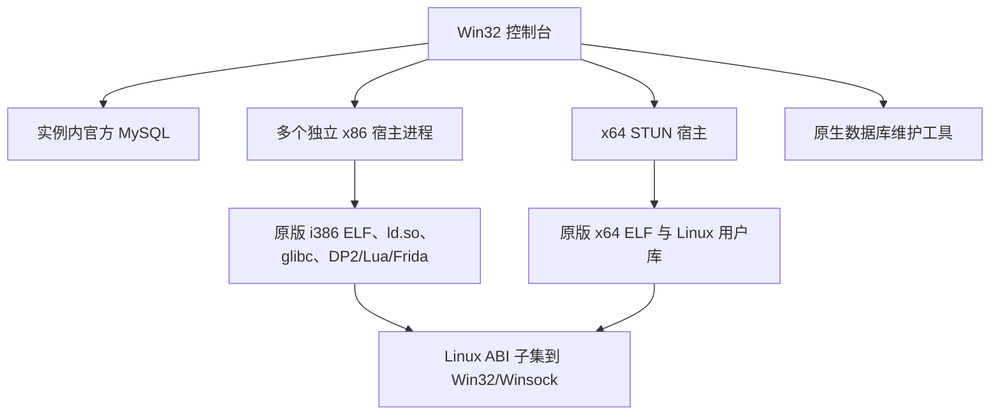

# 实现与兼容边界

本文描述当前源码行为；具体已验证组合和历史故障见[验证记录](validation.md)。服务执行文件来自固定资源基底，项目自研部分是 Windows 宿主、控制台和数据库维护工具。

## 运行关系

普通指令由同架构 CPU 执行，宿主对 syscall 和 Linux TLS 边界进行适配。每个服务是独立 Windows 进程；DP2/Lua/Frida 和 game 保持同进程指针及 ABI。没有引入 CPU 模拟器、通用全程序翻译或内核驱动。

## ELF 宿主

`src/runtime/main.c` 解析 `--map` 和 `--run`，以及 `--root ROOT INTERPRETER_SHA256`、`--cwd`、`--env`。程序 ELF 和动态加载器均按传入 SHA-256 校验，位数不匹配、错误文件边界或缺失入口会明确拒绝。

`elf.c` 以只读文件视图保留输入，再为执行副本映射 PT_LOAD、零填充 BSS 并设置页权限。ET_EXEC 按原地址映射；ET_DYN 分配独立区域。原磁盘 ELF 不因加载和适配被改写。`run.c` 构造 argc/argv、环境、auxv 和初始栈，再经 `entry.S` 进入原动态加载器或程序入口。

`zero.c` 从主 ELF 的动态符号、JUMP_SLOT 重定位及标准 PLT 推导 `memset` 跳转位置，核对原文件与执行副本的完整跳转指令，再仅在执行内存接入；日志记录 ELF 哈希、地址、原字节与恢复来源，不修改原 ELF。首调用及非优化路径执行原 GOT 跳转，保留惰性符号解析；仅在目标已解析到 libc、填充值低字节为零、长度至少 64 KiB 且整个目标属于可写私有匿名映射时，对内部完整页使用 `MEM_DECOMMIT` 后 `MEM_COMMIT`，由 Windows 保证后续读取得到零，边界不足一页的部分实际清零。映射锁覆盖检查与重置，任何失败明确终止并记录；不使用无法保证内容清零的 `MEM_RESET`，不清理工作集来制造短暂下降。共享页、文件 COW、可执行页及其他填充值仍由原 libc 处理；有 `LD_PRELOAD` 的程序完全保留预加载路径，避免绕过插件对 libc 的插桩。没有标准 PLT 的 ELF 正常沿用原路径。该优化降低常驻物理内存，不缩小连接池、虚拟地址范围或提交量。页语义依据 [VirtualFree / MEM_DECOMMIT](https://learn.microsoft.com/en-us/windows/win32/api/memoryapi/nf-memoryapi-virtualfree) 和 [VirtualAlloc / MEM_COMMIT](https://learn.microsoft.com/en-us/windows/win32/api/memoryapi/nf-memoryapi-virtualalloc) 独立实现。

`time`、`gettimeofday` 和 `CLOCK_REALTIME` 继续从 Windows 实时时钟取得 Unix UTC 时间戳；单调时钟继续使用性能计数器，不将本地时区偏移加到时间戳。`run.c` 启动 ELF 时，若没有显式 `TZ`，通过 `GetTimeZoneInformation` 读取本机规则，并由 `timezone.h` 转为 POSIX `TZ` 交给原版 glibc；固定偏移、分数小时、南北半球周期夏令时均保留。该默认值不占用原有 32 项显式环境槽。显式 `--env TZ=...` 优先；按绝对年份指定的转换规则明确报错，当前实现不生成历史时区数据库。时区规则在服务启动时读取，更改 Windows 时区后需重新拉起服务。MySQL 包装器的所有 mysqld 启动路径统一追加 `--default-time-zone=SYSTEM --log-timestamps=SYSTEM`，新实例配置也写入这两项；既有实例无需改配置。GUI 日志原本已使用 `GetLocalTime`。旧日志与已存数据不回写。规则依据 [Windows TIME_ZONE_INFORMATION](https://learn.microsoft.com/en-us/windows/win32/api/timezoneapi/ns-timezoneapi-time_zone_information) 和 [POSIX TZ 环境变量](https://pubs.opengroup.org/onlinepubs/9799919799/basedefs/V1_chap08.html) 独立实现。

`adapt.c` 使用固定 Zydis/Zycore 解码，记录原 syscall/TLS 站点并适配加载副本。x64 syscall 和常规 TLS 陷入经 Windows VEH 分发；x86 `int 0x80` 在异常边界处理。常见 x86 GS 绝对读取可经每线程 Windows TLS 槽和同义 CPU 指令直接执行，保留寄存器与标志。其他已支持的 TLS 由 `tls.c` 处理，未实现站点记录地址并失败退出。

固定 x64 STUN 的历史失败站点已定位为原版 glibc 2.17 `start_thread+0x1b` 的 FS 写入。P15 以当前宿主完成三个原版 pthread worker 的协议与自然停服，结合原版控制流确认该站点路径已覆盖，沿用现有 TLS 实现；通用 ELF 的其他 FS/GS 指令仍以实际支持和验证范围为准，详见[验证记录](validation.md)。

原始 manager 的 GCC PIC 跳转表、特定 Frida 数据/指令和 packed image 处理都有局部识别条件；不能把这些有限适配外推到任意 ELF。所有分发路径的 ENOSYS 记录服务、位数、线程、PC、参数、模块哈希和首次/重复计数；按 1/2/4/8 次采样，返回值保持 ENOSYS。`diagnostics.c` 在 guest 异常边界记录寄存器、原始指令字节、可读局部栈及最多 16 层 frame-pointer 帧；没有帧指针或符号时明确保留未解析地址，不声称完整展开。`tools/elf_manifest.py` 可离线生成资源 ELF 的段、TLS、依赖、重定位类型和未定义动态符号清单，输出必须在 x 下。

| 模块 | 职责 |
| --- | --- |
| `diagnostics.c` | ELF 模块身份、符号定位、重复 ENOSYS 和异常现场；以加载器/VM 原表为准 |
| `run.c` | Linux 初始上下文、异常分发、基础 syscall、内存有效性检查 |
| `vm.c` | mmap/mprotect/munmap/madvise/msync 和有限 x86 mremap；匿名区支持 DONTNEED 的保留映射语义 |
| `files.c` | 实例根目录映射、文件/目录/锁、部分 procfs 和共享文件 |
| `ipc.c` | eventfd 64 位计数、阻塞/非阻塞、信号量及 poll/epoll/select 就绪联动 |
| `net.c` | TCP/UDP、select/poll、LT epoll、已支持的 socket 选项 |
| `thread.c` | 已观察 pthread clone、TLS 接入、futex/wake/requeue 子集及非 PI robust owner death |
| `signal.c` | 当前服务所需处理器、掩码、SA_SIGINFO/SA_RESTORER/SA_NODEFER、嵌套帧及上下文恢复 |
| `tls.c` | Linux FS/GS TLS 指令适配和返回路径 |
| `service.c` | 固定 DBMW/manager ELF 的网络线程停服顺序修正，独立于 syscall 兼容语义 |
| `game.c` | 固定 game 的等级规则及成长奖励包读取修正；进入原程序前校验并修改执行内存 |
| `pvf.c` | 固定 game ELF 的可选视觉模板、宠物列表编号及自动脚本编码适配，独立于 syscall 兼容语义 |

映射表最多 4096 项，记录已使用前缀并复用空槽。VM 修改、内存检查和异常读取使用同一进程内临界区，防止 guest 线程争用映射槽。文件、socket 和 eventfd 共用 `NR_FD_SLOTS=1024` 项描述符，`RLIMIT_NOFILE` 与分配、文件映射、select/poll/epoll 使用同一上限；Winsock 集合容量在编译时核对。该容量满足固定 relay 配置的 1000 个客户端及其内部描述符，实际验证见[容量记录](validation.md)。线程表仍为 64 项，描述符耗尽继续返回 `EMFILE`，不支持任意扩容。

所有描述符创建路径在同一临界区内选择并预留空槽，再初始化资源并发布实际类型；创建失败释放预留槽，关闭时先清理元数据再释放槽。eventfd 的原有创建锁与此锁一致，防止 epoll、socket、文件、管道和 procfs 并发分配同一个 fd。epoll 销毁与关闭 fd 时移除监听的遍历也使用该锁，避免遍历已释放的监听表；阻塞 I/O 不持有该锁。

`/proc/self/maps` 在同一内存锁内从现有 ELF/VM 表生成快照，结合 Windows 实际页权限和部分解除映射的位图，保留 PROT_NONE，排除空洞及已释放区域。共享文件显示共享标志、UTF-8 路径、文件偏移和与 stat 一致的 inode；关闭描述符后仍保留映射身份。它描述本宿主管理的 guest 区域，不枚举 Windows 自身模块。

普通非执行文件的 `MAP_PRIVATE` 使用 Windows `PAGE_WRITECOPY` / `FILE_MAP_COPY` 视图；只读 fd 也可获得私有可写页，写入不会回写文件或其他私有视图，也不移动原 fd 的文件位置。4 KiB 文件偏移通过对齐 Windows 64 KiB 视图并保存实际 view 起点实现；最后一个文件页的 EOF 后部分为零。ELF 依赖仍使用原有 eager snapshot 和指令适配路径，包含 BSS 的预留长度不受普通数据文件的 EOF 限制。普通文件的执行映射和完整超出 EOF、需要 SIGBUS 的页明确返回 ENOSYS。

`munmap` 遍历所有相交 VM 记录，允许跨相邻映射及已解除的空洞。局部释放保留页位图；匿名页 decommit，文件视图页设置为不可访问，直到该记录全部解除后释放实际 Windows view。guest 内存检查和 maps 均排除这些页。程序、解释器、初始栈和 brk 堆的解除仍明确拒绝；跨记录 MAP_FIXED、通用地址复用不由这项修正提供。

`SA_NODEFER` 允许同一未屏蔽信号在 handler 内再次投递，但 action 中的显式 mask 仍然生效。每层 handler 保存独立中断上下文、掩码及 guest 帧，`sigreturn` 逐层恢复。投递仍发生在本项目已有的 syscall/运行时边界；接受 Frida 的处理器注册不代表已支持原生同步访问异常的 Linux 信号转交。

设置 `DNF_NATIVE_EPOLL_TRACE=1` 后，运行时会把 epoll 创建、`EPOLL_CTL_ADD/MOD/DEL`、等待结果以及实际返回事件的 guest fd/data 写入标准错误。该开关默认关闭，用于把事件中的 fd、revents 和用户数据关联起来；不改变事件处理语义。

`service.c` 对固定原版 DBMW 和 manager 的 `CApplication::Free()` 增加局部停服适配。原版 `stop()` 仅清除对象 `+8`，TCP dispatch 实际循环标志在 `+0x2c`；原版清理还在工作线程退出前删除 handler，且没有调用已有的 `pthread_join`。这属于应用生命周期缺陷，不能通过改变通用线程或网络 syscall 语义修复。

适配先核验完整 ELF SHA-256、原地址、完整待改写 MOV 的旧字节及 join 函数入口，再仅在执行内存中将 MOV 的前两个字节改为 UD2。异常分发等待已创建线程完成初始标志设置，清除 accept/TCP/UDP 的实际循环标志；DBMW 通过正常关闭其 UDP 描述符取消阻塞接收，manager 使用其原有一秒 select 返回路径。保留所有对象至工作线程自然退出，随后逐一调用原版 guest join，最后执行被替代 MOV 的原始效果并继续全部原版 Free/析构。超时、布局不符或 join 失败均记录 `service shutdown failed` 并以 126 退出，不继续释放仍在使用的对象。

| ELF | SHA-256 | 适配 PC / 原始 MOV |
| --- | --- | --- |
| DBMW（guild/mnt/stat 同一 ELF） | `0979ef164615e5e3eae006fde74ca2a39a920367dae6a143847dbc0a8d49a967` | `0x806c0c2` / `c70424cdaa1a08` |
| manager | `74b3adba3c2d376547ee65c53940129bd20af9e48926be3f4facc7d729dd65e3` | `0x805e3b4` / `c704241d6e1508` |

适配记录写明哈希、PC、旧字节、替换字节及 `scope=execution-memory`，停服记录各 worker 的 stop/join 结果。磁盘 ELF 和 ZIP 基底保持原字节；回退宿主到此修正之前的构建即可恢复原版执行行为。具体范围不推广到其他服务或任意版本 ELF。只读参考源码提供对象关系线索，地址、布局与指令均重新从上述原版 ELF 核对；未使用参考实现、补丁或生成器。

`pvf.c` 仅针对 game SHA-256 `da417c5e65918f655afcddb6edfdaf2fa1e77b2f208e5aa397f021fa23b79979`，核验原文件和执行副本的地址、完整旧指令及返回位置后，在执行内存适配原有三处：`0x089c1d31` 的模板结果保存、`0x089c1e80` 的动作路径展开入口、`0x0833ccdf` 的宠物解析成功分支。前两处保留原版旧层提交、clear、显式层号和变体名赋值；当视觉模板不存在、装备明确给出正层号、职业为原版 0–11 且模式为 0–2 时，不展开动作路径。这项规则不检查 PVF 身份或模板名称；有效模板继续原版处理，缺失模板需要补充层号或上下文未支持时明确失败，退出 126。没有注册伪模板、借用其他职业模板、删除装备或默认返回成功。

原版 `clear()` 漏清动作字符串 `+0x5c`。缺失模板分支在原元数据赋值后，通过 guest 调用原 `std::string::operator=(char const*)`（`0x08708720`）将该字段清空，再返回原 epilogue（`0x089c2826`）；其余动作字段和向量已由原 clear 清理。调用沿用 guest 参数区、原空串与原 COW 字符串所有权，入口指令及空串也先核验。这样交替加载有效和缺失模板不会残留上一层动作路径，层号与 `+0x60` 变体标识保持不变。

宠物列表允许多个编号共用脚本路径。原导入函数按文件名反查编号，只能得到第一项；适配在原导入成功后恢复当前列表项的真实编号，再执行原版属性转换、装备绑定、数据库同步及查重注册。P23 独立验证了指定 PVF 的 243 个编号和 243 个不同对象。编码默认在 `loadStringTable` 的 `0x088bb551` 读取原版 PackSet 已解密的字符串表，核对计数和偏移后，仅对字符串跨度抽样，按 Windows 严格 GBK／BIG5 解码、常用汉字和私用区字符评分，记录分数与结果。纯 ASCII 保留 BIG5；差异不足或表结构损坏明确失败。`DNF_NATIVE_SCRIPT_ENCODING=GBK`／`BIG5` 继续作为显式覆盖。该位置完整原指令 `8b45f0`、原编码常量和原字符串赋值入口均先核验；通过 guest CALL 调用原 `std::string::operator=(char const*)` 更新脚本编码对象，再执行原 MOV。继续由原 Linux iconv 转换，不改写输入 PVF、数据库编码或客户端编码，也不使用 PVF 哈希白名单。所有修改记录哈希、原字节、替换字节及执行内存范围；结束进程或回退宿主即可恢复，PVF、磁盘 ELF 和固定资源基底不变。

## 等级规则与成长奖励

`src/game_levels.h` 定义 13 个等级选项；GUI 将 `[gameplay] max_level` 传为 game 的 `DNF_NATIVE_MAX_LEVEL`，缺省 70。`runtime/game.c` 仅接受固定 i386 game SHA-256 `da417c5e65918f655afcddb6edfdaf2fa1e77b2f208e5aa397f021fa23b79979`。进入程序前同时核对磁盘与执行内存中的完整原指令，再修改等级立即数；未知版本、旧字节不同、重复或无效配置明确拒绝。日志保存身份、地址及旧/新值；进程退出释放映射即恢复，不生成替换 ELF。

以下是依据基底原指令、函数用途独立确定的 15 处操作数，L 为所选上限；十六进制 46/45 分别为原 70/69。SP 初始化/读取、升级事件、状态经验边界、升级道具及角色上限同时调整。

| 操作数字节地址 | 原值 → 新值 | 原函数 |
| --- | --- | --- |
| `0x08360c3b`、`0x08360c79` | `46` → L | `CDataManager::set_reward_sp` |
| `0x08360cc4` | `46` → L | `CDataManager::GetSpAtLevelUp` |
| `0x08662f55`、`0x086630f3` | `46` → L | `CUser::_check_level_up` |
| `0x086638f6` | `46` → L | `CUser::_onLevelUp` |
| `0x08665d28`、`0x08666e9c` | `45` → L−1 | `CUser::increase_status` |
| `0x0866a4a8` | `45` → L−1 | `CUser::gain_exp_sp` |
| `0x0866a659`、`0x0866a929`、`0x0866a941` | `46` → L | `CUser::gain_exp_sp` |
| `0x08689d4b` | `45` → L−1 | `CUser::CalLevelUpItemCheck` |
| `0x0868fece`、`0x0868feda` | `46` → L | `CUser::SetUserMaxLevel` |

基底 `Dispatcher_Select_Item_Grwoth_Power::read` 在 `0x081db4ea` 的 `74 00` 使成功读取也落入错误块。原正常继续地址为 `0x081db512`，按相对分支公式计算偏移为 26，执行内存修正为 `74 26`。合法选择继续解析；空包和截断选择仍返回原 `0x4a55`、`0x4a5a`。这属于固定原程序的包读取错误，与具体 PVF 无关，不跳过读取或错误检查。

用户提供的 13 份等级 ELF 只作为只读差异证据：70 级版已有 76 字节、35 组与等级无关的改动，其他版本再增加 15 个等级字节。项目不接入这些替换 ELF、不重放共同改动；来源差异见[第三方记录](third-party.md#用户提供的等级补丁)。本功能不重建经验/SP 表或客户端内容，也不回写既有角色等级、经验。

## 控制台与实例

game 的应用初始化状态取自当前宿主本次创建的 stdout，逐段读取原版 `server has been started successfully.` 完成标记，并保留跨段匹配所需的尾部；不会读取旧 `.init` 或上次启动的 stdout 来更新状态。每次启动清零读取位置和初始化标记，退出后显示宿主已退出。此层级确认原程序报告初始化完成，接口、协议和业务验证仍独立；其他服务没有经确认的原版完成标记，继续显示运行时通道层级。

`src/controller/controller_gui.cpp` 使用原生 Win32 控件和一个后台操作线程，操作进行时限制冲突按钮。共享文件接口在 `src/win32_files.h`，支持 Unicode 路径和私有文件权限；ZIP 通过 miniz 和 Win32 HANDLE 解压。

实例路径由共享 `instance_directory()` 规范化，GUI 与 `mysql-control` 使用相同入口。原版 MySQL 5.7.44 无法使用本次实测的扩展长工作目录或长 `datadir`；根路径达到 `MAX_PATH` 时查询已有的文件系统短名，只有结果短于该限制才用于运行。长短名仍指向同一物理目录，实例锁、UUID、数据和冷副本均保留原位；没有创建目录链接、调整系统设置或更换数据库。文件夹选择器通过 `SHGetNameFromIDList` 取得路径，并恢复完整长名供显示。根路径未达限制时仍按普通绝对路径处理；任意子路径长度、无短名卷和 UNC 支持不在该修复的保证范围内。

当前 GUI 按用户指定的 `Desktop/win32/preview.png` 视觉规格独立重排为四块：顶部实例控制、7 列服务卡片、独立 MySQL 横条和日志工作区。19 项服务保持 `services.ini` 顺序与身份，不引入参考演示模型。原生 LISTBOX 通过 `LBS_OWNERDRAWFIXED` 持有字符串与选择；原生逐项绘制通知由网格统一接管，避免选中时短暂露出系统蓝色条。自绘、鼠标命中、`LB_GETITEMRECT` 和方向键共享同一行优先网格；19 个服务各有按卡片矩形注册的原生 tooltip，文本由 UI 字符串快照中的服务名映射到简要用途，仅显示功能说明，缩放或实例切换时更新命中区域，空白区域不注册提示；操作期间绘制使用 UI 线程的字符串快照，不读取工作线程正在修改的服务对象。移除旧分组、折叠和功能筛选。服务区仅保留“功能”按钮，等级和插件控件实际创建于该窗口；右键菜单仅保留“启动所选”“停止所选”“检查资源”三个四字动作，选择卡片直接查看日志。菜单与命令处理共享当前选择、运行状态及数据库依赖判定。顶部“检查资源”同时将所选服务的元数据、根目录、CWD、ELF 哈希、架构、停服信号及就绪层级输出到主日志，原服务详情按钮和信息弹窗已移除。目录与 IP 输入框分组留有独立间距，IP 标签始终显示。MySQL“详情”显示数据库身份、逆序停服计划及维护结果；实例初始化与删除收至顶部菜单。日志保留原生文件选择状态，通过标签和文件菜单操作，新增只作用于显示的关键字过滤。

窗口与服务网格使用 GDI 双缓冲，主窗口使用 `WS_EX_COMPOSITED` 合成子控件；调整大小时用 `BeginDeferWindowPos`／`EndDeferWindowPos` 批量更新控件位置，禁止中途重绘和旧像素拷贝，再同步刷新。重复点击已选模块不重新触发选中通知或日志扫描。按钮按鼠标、按下、禁用和键盘焦点绘制，保留原生回车及 Tab 行为。尺寸按客户区及 DPI 重算，清单声明每显示器 DPI 感知，DPI 变化同时重建字体；先对逻辑行坐标缩放，避免 125% 时逐行舍入累积越界。当前最小窗口为 1180×760 DIP；模拟 DPI 检查不能代替实际多显示器或其他系统验证。参考工程保持只读，未复制、编译或接入其源码、模拟业务及构建产物。P19 的原始构建、截图和验证收据位于仓库外 `../x/dnf-native-output/P19-20261116-reference-gui/`。

`instance_setup.h` 从 v4 清单校验两个 ZIP、两个宿主和数据库维护工具的身份。新建仅接受空目录，解压后逐文件核对；官方 MySQL 安全初始化后导入 18 个应用库，重新导出与种子 SHA-256 比对。随后生成每实例应用账号、更新数据库连接、准备当前月表、写入服务配置，正常停库后提交实例。失败保留 pending 标记和私有诊断。

新资源包以一个 Linux 目录树释放到实例根目录，服务清单 `root=.`；`home/neople/` 汇集所有服务，`dp2/` 保存插件，`lib/` 与 `lib64/` 保留 Linux 原有库位数区分。已有拆分目录实例继续由原清单解析，不自动迁移用户数据。

`services.ini` 保存 19 个服务的宿主位数、根目录、原 ELF 与 loader 哈希、参数、环境、停服信号和自动启动标志。顺序是 bridge、manager、三个 DBMW、monitor、guild、statics、coserver、community、auction、point、channel、relay、stun、game；zergsvr/secagent/gunnersvr 默认不自动启动。

安全组件已用固定原版 ELF 实测加载，但资源中的拓扑不完整：zerg 默认向配置服务取信息；改用原版支持的 `cfgfile` 后，`svcid.xml` 的完全重复条目会被拒绝。仅在诊断副本去重后，安全监控 `[31|570001]` 与 zerg `[30|570011]` 仍共用 `127.0.0.1:9000`，形成自连，配置端点 `[2|1]` 的 9001 没有实际对端。DNF monitor 与这个安全监控角色不同；产品保留原配置及三个独立入口，没有发布不完整的诊断拓扑。

`service_processes.h` 先以挂起状态创建宿主、加入本窗口的 Job，再恢复执行并等待停服通道。该通道接入后显示“进程运行中”；game 再依据本次 stdout 更新为“应用已初始化”。正常停止使用本项目命名事件向原程序交付信号；STUN 另发 UDP 数据唤醒阻塞接收。超时保留进程和依赖供诊断。正常停服后仅清理由本窗口已退出宿主拥有的 PID 标记。在线计数每 500ms 查询本窗口服务 Job 的实际进程，再以父 PID 筛选直接启动的服务宿主，排除控制台辅助进程；UI 绘制仅使用 PID 与告警快照，避免与后台关闭进程句柄竞争。请求停服后的退出码保留原值：固定 CApplication 模块返回 1 且本轮日志包含 `Application Stop!` 时按正常停止显示，其他非零退出和超时继续标红。

实例选择持有独占 `.instance.lock`。成功打开有效实例后，立即以 UTF-16 配置原子保存列表及最后选择到当前用户 `%LOCALAPPDATA%\DNF-Native\instances.ini`，不要求启动数据库或服务；启动时恢复，`--instance` 显式参数优先。列表去重并保留最多 64 个路径；删除实例同步移除记录，启动时跳过已不存在的实例。配置保存错误写入主日志，运行包与实例配置均不承载这份界面设置。删除仅允许已识别、已停止的真实实例目录，需要确认；递归处理普通目录，遇 reparse point 只移除链接自身。资源 ZIP 和外部原件不作为运行实例写入。

键盘导航沿用 `IsDialogMessageW` 和原生控件。自绘按钮在 `WM_GETDLGCODE` 中声明当前焦点按钮的回车语义，处理 `BM_SETSTYLE` 时保留 `BS_OWNERDRAW`，避免 Windows 切换默认按钮时恢复普通灰色样式。只读多行日志/详情框对 Tab 释放 `DLGC_WANTALLKEYS/WANTTAB`，保留其他文本选择和滚动行为。删除和还原使用默认“取消”的确定/取消框；回车默认取消，Esc 由原生模态框取消，不为主窗口增加直接退出快捷键。

IP 更新集中于 `service_ip.h`，修改前备份原配置；DP2/Lua/Frida 环境由服务清单和插件模式生成。`log_view.h` 与 GUI 仅读取原日志末尾至多 256 KiB，支持编码、轮转、截短、跟随及显示过滤，不改写原始日志。日志控件不设置可见滚动条，显式处理 `WM_MOUSEWHEEL`，累积不足一格的滚轮增量，遵循系统行数／整页设置，并通过 `EM_LINESCROLL`／`EM_SCROLL` 滚动。消息循环将日志上方的滚轮转交到日志控件，键盘焦点无需离开其他控件；向上滚动关闭跟随，后续刷新保留阅读位置。控制台操作记录单独显示。

## 数据库维护

`src/database/mysql_control.cpp` 调用实例自己的官方 MySQL 5.7.44 工具。产品不安装服务，也不扫描和复用本机其他 MySQL。GUI 运行时通过 SQL 核对版本、server UUID、本次 PID 文件名及 TLS，确认属于本窗口的数据库后才发正常停库命令。

`mysql_operations.h` 实现：

1. **备份**：确认数据目录已停止，以禁 TCP 的独立共享内存端点启动维护数据库，逻辑导出全部库、账号、存储程序、事件和触发器，正常停库后写入带哈希的清单。
2. **还原验证**：验证备份、连接配置及实例 UUID，先保存当前逻辑预备份，再逐文件复制并核对冷数据到影子目录；只在影子副本中移除旧应用库并导入。
3. **提交**：重启影子库、重新导出并逐字节核对逻辑备份，写 `restore.pending` 后保留旧冷目录、切入新目录，启动核对身份并正常停止，再删除 pending 标记。
4. **恢复**：失败或中断时通过 pending 日志恢复原冷目录，保留被拒绝的数据和诊断；解析无效的日志会明确失败，不猜测恢复。

MySQL 的 NTFS 配置使用 `lower_case_table_names=1`。历史原库导入和二进制/存储程序往返另有独立证据，不能据一次简单 SQL 查询推断所有数据库语义。中文 defaults 路径使用实例工作目录内的相对配置名。

`controller/monthly_tables.h` 根据原服务实际列清单维护 `taiwan_cain_auction_gold`、`taiwan_cain_auction_cera` 的 `auction_history_YYYYMM`（26 列）、`auction_history_buyer_YYYYMM`（8 列），以及 `taiwan_cain_log.log_response_time_YYYYMM`（6 列）。月份由 MySQL `NOW()` 计算，当前月与下月均准备，不再从不完整种子表 `LIKE` 复制。响应日志使用 `channel_no,occ_time,packet_id,packet_count,total_response_time,avg_response_time`，旧种子同名表实际是其他统计结构。

新实例导入后、数据库启动后及 game/auction/point 启动前运行月表维护；持有数据库时每 15 分钟由单一后台操作线程复查。运行中允许建立缺失月表；修改既有结构要求这三个写入服务均停止。拍卖表仅补缺列；不识别的关键字段结构明确拒绝。响应表通过原表改名保存、正确新表原子换名处理。每次修改既有表前由官方 `mysqldump` 导出并记录 SHA-256，预先写回滚 SQL；迁移后核对字段，核对失败时执行回滚，失败现场与恢复 SQL 保留。拍卖回滚先改名保留迁移后表，再导回原结构和数据；响应回滚交换原表名称。月表维护不删除历史月份；主动重置市场数据库是下面独立的红字操作。

## 双拍卖维护

`controller/auction_window.h` 提供维护窗口，复用主窗口按钮、开关和单一后台线程；`auction_maintenance.h` 管理检查、备份、迁移与恢复；`auction_pvf.h` 独立读取 PVF；`runtime/auction.c` 适配固定原版 i386 auction／point。功能与作用域见[使用说明](README.md)。配置保存到已有 `services.ini [auction]`，保留原服务入口等字段；`extend_levels/extend_refine/dp2_guard/auto_check` 是选项，`level_limit/refine_limit` 是应用后的数值。宿主环境由控制台生成。

维护窗口摘要由两条单行 STATIC 组成：PVF 路径采用路径省略并提供完整路径提示，第二行显示 auction／point 状态。下方为运行设置、兼容设置及一个合并维护面板；运行设置按等级下拉框、DP2、Frida 从左到右横排一行，应用并重启按钮靠右对齐，不再创建独立插件保存按钮及说明文字。一次工作线程快照同时保存等级与插件模式；game 运行时只停、启一次，其他服务不重启；停服时保存供下次启动使用。无变化时禁用应用按钮。写入前核对固定 ELF 哈希与 Lua 入口，先在实例 `.mysql/runtime-settings-*` 保留配置和需要修改的模块；写配置失败恢复原文，错误写入主日志。八个维护动作按两行四列布置，第一行索引、第二行红字数据操作。UI 不再创建市场范围控件，所有维护动作固定以范围 2 同时处理两个拍卖库，仍沿用备份及失败回滚。没有底部关闭按钮，标题栏与 Esc 使用同一正常关闭路径。执行结果与详情统一写入主窗口日志，不再单设报告区；摘要与所在横条使用同一底色。所有动作使用同一行高和列边界；主窗口与维护窗口的开关由自绘控件处理悬停、禁用、焦点和开启状态，轨道及圆形滑块先按 4 倍分辨率绘制，再以 HALFTONE 缩小，文字保持原生 DPI；鼠标点击隐藏整圈焦点框，键盘 Tab 导航时按 Win32 UI 状态显示焦点提示。

主窗口标题栏每 500ms 通过 Toolhelp 进程快照，从控制台 PID 递归查找全部子进程，包含控制台、ELF 服务、数据库包装器、mysqld 和临时数据库工具。逐进程只读打开句柄，汇总 `GetProcessTimes` 的内核与用户 CPU 时间差和 `GetProcessMemoryInfo` 的当前工作集。CPU 按 `GetTickCount64` 采样间隔及全部逻辑处理器数量归一化，内存为工作集之和（共享驻留页可能重复计入）。PID 加创建时间识别进程，首次采样建立基线，退出后移除；读取失败显示 `--`，不沿用旧值。独立采样句柄避免读取后台线程关闭或替换的服务句柄；不统计其他控制台实例或无关进程，不作为服务就绪或业务成功信号。

控制台创建服务宿主与数据库包装器、包装器创建 mysqld 时使用 `DETACHED_PROCESS` 并继续显式传递日志与输入句柄，省去各常驻进程的隐藏 conhost。短期 MySQL 命令行客户端保留 `CREATE_NO_WINDOW`：其字符集 `auto` 依赖 `GetConsoleCP()`，直接分离会返回 cp0 并把警告混入 SQL 输出。该保留不会产生随服务器长期运行的控制台辅助进程。

Toolhelp 快照的父 PID 可能属于已经退出的旧进程，因此不能仅按编号递归归属。采样先以 `PROCESS_QUERY_LIMITED_INFORMATION` 查询候选创建时间，仅纳入创建时间不早于本次父进程的候选，再请求工作集读取权限；旧系统进程因此在访问内存前被排除。采样时再次核对创建时间，跳过查询期间已经复用的 PID。真实成员读取失败仍显示 `--`，不把旧系统进程的访问拒绝当成本项目采样失败。

固定 ELF 身份分别为 auction `b31eafd5068b450929133365f071fc2d0dedc7a8a5b80f9c81da44ce4008290c`、point `0339aa6cc51f32c4b50fe9e55f3fd8b00d4b495fcad46871c59a5eda345c9256`。每个站点先核对文件与执行映射的完整旧指令，再写执行内存，并记录旧新字节；不修改磁盘 ELF，退出后恢复。具体站点与预期字节集中在 `auction.c`，拒绝其他 ELF 身份。

搜索原本用动态 map 保存锻造维度，但请求校验只接受 0～7；`0x0808281c` 只调整该上限，等级在 `0x080811d5/0x0808292b/0x08083471/0x0808347c` 调整。范围取当前 PVF；等级受原指令表示限制到 127，锻造受 `UpgradeSeparateInfo::GetUpgradeSeparate` 的五位物品协议限制到 31，超限明确拒绝。不会把 PVF 压回 70／7，也不把请求改成任意 127。

原均价容器只构造每强化 8 档 map，直接放宽校验会使锻造 8 与下一强化档锻造 0 共用地址。现在每 8 个锻造值使用一个完整原版 `AveragePriceDictionary`：额外组独立构造、保留原算法、对象池、ROI 和约束，make／Add／Get 按组转发，Update／析构覆盖各组。外层 Auction 仍序列化真实锻造值。数据库普通均价主键及 ROI 唯一键加入 `seperate_upgrade`；人工均价补该列，原人工更新 SQL 的 join 也匹配锻造值。只有 schema 标志存在时启用 SQL 适配，不猜测迁移未知唯一键。

PVF 解析读取目录、字符串表、equipment／stackable 主列表、实际脚本及 PVF 内 `etc/iteminfo.dat`。支持 GBK／Big5 自动判断、9／10 间接名称引用以及自带 PVF 表尾的 `[explain]` 说明，合并当前真实名称、稀有度、等级和职业。分类依据当前 PVF 自带条目与类型／子类型／目录的无歧义证据；没有依据、无名、原版缓冲无法表示的条目列为待处理，不用编号假名、不凭空填分类。金币条目只有主列表及脚本实际存在才保留。UTF-8 的 17 字段 dat 同步到两市场；原 CodePage 初始化改为 UTF-8，原 `script2Database` 同编码分支不填目标缓冲，因此执行内存回调补上真实复制，防止中文名变空。

两个原市场的 `NextToken`（`0x0807c9a4`）把每个负 char 与后一个字节一起复制，属于双字节编码规则；UTF-8 名称含奇数个高位字节时会吞掉结束引号，把英文名和分类读错。仅在 `DNF_NATIVE_AUCTION_ENCODING=UTF8` 模式下，以独立的逐字节拆分函数替换其入口，保留 ASCII 引号、分隔符、空名称和原静态缓冲调用约定；不修改搜索谓词。入口完整旧指令 `55 89 e5 83 ec 38` 与固定 ELF 哈希同时验证，变更只在执行内存中，重启原服务重新从现有订单建立索引。

`controller/game_compat.h` 在启用 DP2 的固定 game 启动前安装有标记的 Lua 兼容段，首次备份入口，后续只替换自身旧段，保留用户内容。实际 DPX 的 `set_auction_min_level(number)` 在多次完整启动中把随栈位置变化的值写入门槛；调用 `_DP.mem.hotfix` 传入单字节字符串可正确写入。兼容段独立重建同名 Lua 接口，接受整数 0～127，经 `string.char` 写入并回读；没有声称已完整反解 DPX 内部错误。固定 game 身份为 `da417c5e65918f655afcddb6edfdaf2fa1e77b2f208e5aa397f021fa23b79979`，写入前核对 `0x08213f27` 的 `cmp eax,imm8` 和随后 `setle/test` 指令。只更换比较操作数，保留严格大于门槛的规则与原错误路径；每次记录原值、新值和地址，磁盘 ELF 不变，原 ZIP 不变。

检查覆盖两个市场的 `auction_main` 和普通／ROI／人工均价，核对实际 ID、可索引性、强化／锻造／等级、旧名称／分类／稀有度，以及上次同步记录的类型、路径、大小和目录 CRC。订单与均价冲突分别列出；自动同步不删除其中任何数据。`auction_system_main` 在本基底只含排程字段，没有物品 ID，清空在售时显式清除。已有索引及定义记录用于检测 ID 改用途；首次迁移没有旧定义身份时只能比较现有索引字段，不能证明脚本全部语义相同。

索引清单 `.mysql/market-index.ini` 绑定 PVF、两份 dat 哈希和 UTF-8 编码，定义记录另存 `market-definitions.txt`。相关启动前及 15 分钟复查发现哈希变化后检查候选；关闭自动检查时由维护窗口手动应用。候选在内存完整生成后才进入写入。写操作限定当前控制台 SQL UUID／PID／TLS 身份；停止本窗口持有的三个写入服务后再次检查，官方 SQL 备份覆盖选中市场全部表。索引操作额外备份 dat、配置、manifest、定义与 DP2 脚本，以临时文件和原子替换提交。失败导回 SQL 及原文件，保持相关服务停止；成功按原运行集合重新拉起。上一版 dat 绑定其旧 manifest 的 PVF，未知来源记录为空，恢复时拒绝不同或未知 PVF。

DP2 搜索保护仅替换明确识别的搜索 hook 段，保留周围凭据和用户代码；未知自定义 hook 明确拒绝启用，关闭只还原本项目已安装的段。按原分发入口解析每项，只对有效装备 ID／实例 ID 和装备组查询，要求 SQL 成功、有且仅一条、HEX 为恰好 30 字节并带非空孔记录才覆盖；无记录及失败保持原包字节，加入重入保护与异常日志。此实现未改变上架、购买、定价和机器人逻辑。

## 已确认的兼容限制

- 当前采用原服务的前台 `run/nofork/test` 入口；通用 fork/exec/wait、setsid 和后台父子语义未提供完整支持。
- `/dev/shm` 的真实共享文件映射已有路径；System V shm/sem 不等于文件映射，尚无通用实现。
- 网络以现有 TCP/UDP、select/poll、LT epoll 路径为主；AF_UNIX、完整 sendmsg/recvmsg 辅助数据、ET/ONESHOT 等未完成。
- 非 PI robust list 注册及正常线程退出时的 owner death、pending 节点与进程内唤醒已有实现；PI 锁、跨进程 futex、强制终止后的恢复、线程退出槽复用、pthread cancel 和通用线程定向信号未完整覆盖。
- SA_SIGINFO/SA_NODEFER 已支持固定 i386/x86_64 `siginfo_t`/`ucontext` 帧、嵌套投递、GPR/PC/SP/flags/掩码修改及 `rt_sigreturn`；浮点扩展状态、备用信号栈、同步异常转交、纯计算中的异步抢占和完整 syscall 中断/重启语义仍有限。
- 匿名私有映射的 `madvise(MADV_DONTNEED)` 使用 Windows `MEM_RESET` 保留地址、权限和并发访问；Windows 不保证 Linux 下一次读一定立即得到零页，因此不能把它扩展为通用页面回收或跨进程共享语义。
- 打开目标上的 POSIX rename、符号链接、普通文件执行映射、EOF 外整页的 SIGBUS、跨多个预留区固定映射及部分 msync 行为存在边界。
- inotify_init/init1 仍返回 ENOSYS；固定原版 Frida Gadget 的 `GPollFileMonitor` 轮询回退已通过覆盖写入、原子替换和新版 RPC 结果验证，延迟约 5 秒。无需为此路径增加文件监视兼容层；通用 inotify、全部编辑器行为和业务运行中的任意脚本热加载不在已验证范围。
- 保留原地址不等于任意等级 ELF/PVF 都兼容；每个新组合都需要匹配资源和独立业务验证。

## 基底与源码的关系

`native.zip` 继承已验证阶段的局部 monitor 适配、插件脚本和原包 PVF；这些不是本次整理新加入的补丁。来源、旧字节与恢复边界保留在 `docs/evidence/history.json` 的历史记录及清理前提交 `fbb11f3` 的重建工具中。新修改原版指令仍须遵守 `AGENTS.md` 的身份、地址、旧字节和恢复记录要求。

普通打包不重放旧 CAB 转换或修改基底。需要更新资源时，应先生成独立候选、核对来源差异、验证实际路径，再更新 ZIP、逐文件清单与基底哈希。历史实验不因目录迁移成为当前支持承诺。

## 独立登录器

`src/login/` 由用户明确授权提供的 C 工程导入，来源哈希见 `evidence/login-source.json`。它是独立客户端程序，手动连接 MySQL、注册四表并签发原令牌，不读取或依赖服务实例。改动包括当前密钥对导出、无效外部密钥拒绝、去除硬编码私有默认连接、Unicode 客户端路径和子进程游戏地址传递、注册附表失败报错。公钥通过 Windows CryptoAPI 从当前私钥实际 n/e 导出；默认私钥仅以 `resources/login/private_key.pem` 维护，构建在外部生成内嵌头。固定服务资源仅更新默认公钥。正式运行目录仅附登录器 EXE，源码保留在仓库，不包含用户客户端或数据库。使用与限制见 `login.md`。

TCP 的 FIN／RST 在 Windows WSAPoll 中可能仅返回 HUP／ERR。Linux 的读就绪必须让调用方读出 EOF 或待决错误，因此兼容层在 socket HUP 时保留 HUP，并补上调用方请求的 POLLIN／POLLRDNORM；epoll 同步得到 EPOLLIN。原 monitor 通过可读事件读取断开并清除频道，同一 game 正常停止后可重新注册，不能通过跳过重复频道检查掩盖。

新实例的公开演示登录使用用户指定的 game 数据库凭据和 test 游戏账号，四张登录表在初始化时建立；内部 dnf_game、维护 root、bridge 和 frida 仍按原职责使用实例凭据。登录器不读取服务端配置，默认值明文显示；控制台数据库详情显示当前实例实际连接参数，不记录到控制台日志。
